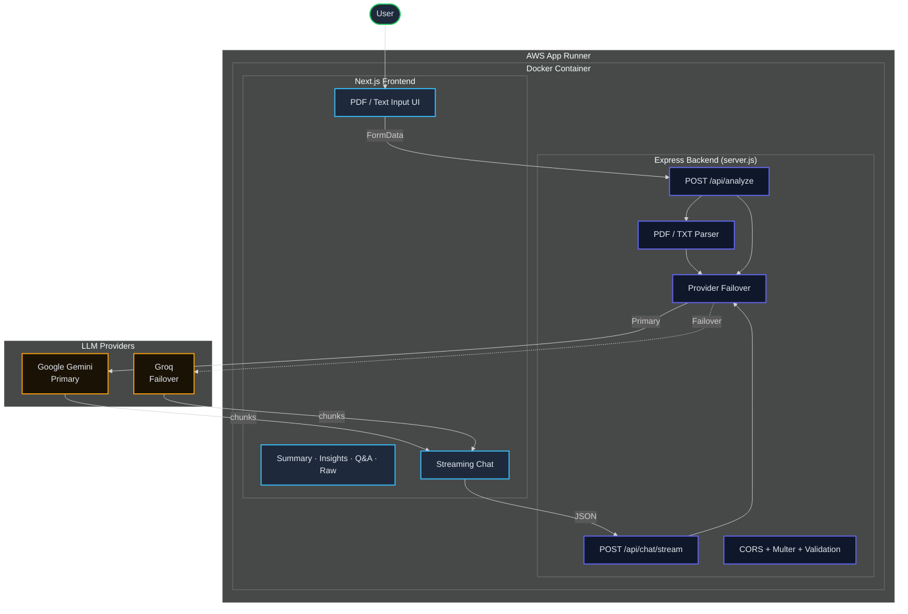

# DocuSense — AI-Powered Document Analyzer

[](https://nextjs.org)
[](https://react.dev)
[](https://www.typescriptlang.org)
[](https://tailwindcss.com)
[](https://www.docker.com)
[](https://aws.amazon.com/apprunner)

DocuSense is a full-stack AI document Q&A platform. Upload a **PDF** or **TXT** file (or paste raw text), get an AI-generated executive summary and key insights, then ask questions about the document and receive answers **streamed progressively** in real time.

It ships with **dual LLM support** — Google Gemini (primary) with automatic failover to Groq — and a **demo/mock mode** that works with zero API keys so the UI is always usable.

---

## Table of Contents

- [Features](#features)
- [Architecture](#architecture)
- [Project Structure](#project-structure)
- [Tech Stack](#tech-stack)
- [Getting Started](#getting-started)
- [Environment Variables](#environment-variables)
- [Running Locally](#running-locally)
- [Production Build](#production-build)
- [Docker](#docker)
- [AWS App Runner Deployment](#aws-app-runner-deployment)
- [API Reference](#api-reference)
- [AI Provider & Failover Logic](#ai-provider--failover-logic)
- [Demo / Mock Mode](#demo--mock-mode)
- [Available Scripts](#available-scripts)
- [Troubleshooting](#troubleshooting)
- [Security Notes](#security-notes)
- [Known Limitations & Roadmap](#known-limitations--roadmap)

---

## Features

- **PDF / TXT upload & parsing** — Drag-and-drop or browse files; text is extracted server-side with `pdf-parse`.
- **Paste-text mode** — No file needed; paste raw text directly into the analyzer.
- **AI executive summary** — Markdown-formatted summary with headings, bullet points and blockquotes.
- **Key insights extraction** — 4–6 structured insight cards (`tag`, `title`, `desc`).
- **Streaming Q&A** — Token-by-token answers via a `ReadableStream`/chunked response, rendered live in the chat UI.
- **Dual LLM with automatic failover** — Gemini first, Groq fallback (order configurable via `AI_PROVIDER`).
- **Zero-key demo mode** — Mock analysis + simulated typing stream when no API keys are configured.
- **Secure key handling** — All LLM calls happen server-side; keys are never exposed to the browser.
- **Light / Dark theme** — Persisted in `localStorage`.
- **Document metadata panel** — Source name, file size and format.
- **Raw text viewer** — Inspect and copy the extracted document text.
- **Single-container deployment** — Express custom server serves the Next.js app and the API together.

---

## Architecture



### Request Flow

1. **Upload / Paste** — The browser sends a `multipart/form-data` request to `POST /api/analyze`.
2. **Extract** — The server reads the PDF (`pdf-parse`) or TXT buffer and returns the full text.
3. **Analyze** — The extracted text (truncated to 45,000 characters) is sent to the configured LLM with a prompt requesting a Markdown summary plus a JSON array of insights.
4. **Respond** — The server parses the JSON and returns `{ summary, insights, provider, isMock, text }`.
5. **Ask** — The Q&A tab sends `{ text, question }` to `POST /api/chat/stream`.
6. **Stream** — The provider's stream is normalized to raw text chunks and forwarded to the browser, which appends each chunk to the active chat bubble.

> **Important:** `next.config.ts` rewrites `/api/:path*` to `http://127.0.0.1:3001/api/:path*`. During development this routes API calls from the Next dev server (port 3000) to the Express server (port 3001). In the Docker/production setup, `server.js` handles `/api/*` directly before delegating everything else to Next. The `src/app/api/*` route handlers are a **legacy/standalone Next-only implementation** and are not used while Express is running.

---

## Project Structure

```
IBM/
├── src/
│   ├── app/
│   │   ├── layout.tsx              # Root layout + metadata (DocuSense title/description)
│   │   ├── page.tsx                # Main dashboard: state, tabs, upload, theme, markdown render
│   │   ├── globals.css             # Design system, light/dark themes, component styles
│   │   ├── favicon.ico
│   │   └── api/                    # Legacy Next.js route handlers (used only without Express)
│   │       ├── analyze/route.ts    # POST analyze (PDF/TXT/raw text) — Gemini + Groq
│   │       └── chat/stream/route.ts# POST streaming Q&A — Gemini + Groq
│   └── components/
│       ├── FileDropzone.tsx        # Drag-and-drop / file picker (PDF, TXT)
│       ├── AnalysisTabs.tsx        # Summary / Key Insights / Q&A / Document Text tabs
│       └── QAInterface.tsx         # Streaming chat UI with ReadableStream decoder
├── public/                         # Static SVG assets
├── server.js                       # Express custom server: API + Next.js handler
├── next.config.ts                  # /api rewrite to Express on port 3001
├── tsconfig.json                   # TypeScript config with "@/*" path alias
├── eslint.config.mjs               # ESLint (Next core-web-vitals + TypeScript)
├── postcss.config.mjs              # Tailwind CSS v4 PostCSS plugin
├── Dockerfile                      # Single-container production image
├── .dockerignore
├── .env.example                    # Environment variable template
├── package.json
├── walkthrough.md                  # Notes on the Dockerization / streaming implementation
└── README.md
```

---

## Tech Stack

| Layer | Technology |
|-------|------------|
| Frontend | Next.js 16 (App Router), React 19, TypeScript 5 |
| Styling | Tailwind CSS 4 (`@tailwindcss/postcss`) + custom CSS design system |
| Backend | Node.js, Express 4, custom Next.js server |
| File handling | Multer (in-memory), `pdf-parse` |
| AI/ML | Google Gemini (`@google/generative-ai`), Groq (OpenAI-compatible API) |
| Tooling | ESLint 9, `eslint-config-next`, concurrently |
| Deployment | Docker (`node:20-alpine`), AWS App Runner |

---

## Getting Started

### Prerequisites

- **Node.js 20+** (the Docker image uses `node:20-alpine`)
- **npm**
- Optional: **Docker** for containerized runs
- Optional: API keys for [Google Gemini](https://ai.google.dev/) and/or [Groq](https://console.groq.com/)

### 1. Clone the repository

```bash
git clone https://github.com/Jayant-Baliyan/DocuSense.git
cd DocuSense
```

### 2. Install dependencies

```bash
npm install
```

### 3. Configure environment variables

```bash
cp .env.example .env
```

Then edit `.env` and add your keys (see [Environment Variables](#environment-variables)). You can leave both keys empty to use demo mode.

---

## Environment Variables

| Variable | Required | Default | Description |
|----------|----------|---------|-------------|
| `GEMINI_API_KEY` | No* | — | Google Gemini API key. |
| `GROQ_API_KEY` | No* | — | Groq API key (OpenAI-compatible). |
| `AI_PROVIDER` | No | `gemini` (if Gemini key exists) | Preferred provider: `gemini` or `groq`. The other becomes the failover. |
| `GEMINI_MODEL` | No | `gemini-3.5-flash` | Gemini model name. |
| `GROQ_MODEL` | No | `llama-3.3-70b-versatile` in code; `llama-3.1-8b-instant` in `.env.example` | Groq model name. |
| `PORT` | No | `3001` | Port the Express server listens on. **Set explicitly in Docker** (see below). |
| `NODE_ENV` | No | `development` | `production` enables Next production mode and optimized output. |

\* At least one key is needed for real AI responses. With **no keys**, the app runs in [demo/mock mode](#demo--mock-mode).

> **Note:** `.env` is git-ignored; only `.env.example` is committed. Never commit real API keys or the `DocuSense_KeyPair.pem` file.

---

## Running Locally

Because the Next.js dev server rewrites `/api/*` to `http://127.0.0.1:3001`, you need **both** processes running: the Express API and the Next frontend.

### Option A — One command (recommended)

```bash
npx concurrently "node server.js" "npm run dev"
```

- Express API + custom Next server: `http://localhost:3001`
- Next dev server: `http://localhost:3000`

Open **http://localhost:3000**.

### Option B — Two terminals

```bash
# Terminal 1 — API backend
node server.js

# Terminal 2 — Next.js frontend
npm run dev
```

> Running only `npm run dev` will make `/api/*` calls fail because nothing is listening on port 3001. Likewise, running only `node server.js` in dev mode serves everything on 3001, not 3000.

---

## Production Build

```bash
npm run build
$env:NODE_ENV="production"; node server.js   # PowerShell
# NODE_ENV=production node server.js          # bash
```

`server.js` starts a single Express server that:
1. Handles `/api/analyze` and `/api/chat/stream` directly.
2. Returns JSON 404 for unknown `/api/*` routes.
3. Delegates all other requests to the Next.js handler.

The app listens on `process.env.PORT` (default **3001**).

---

## Docker

The `Dockerfile` installs dependencies, builds Next.js, sets `NODE_ENV=production`, and runs `node server.js` as a single process.

### Build

```bash
docker build -t docusense .
```

### Run

```bash
docker run -p 3000:3000 \
  -e PORT=3000 \
  -e GEMINI_API_KEY=your_gemini_key \
  -e GROQ_API_KEY=your_groq_key \
  -e AI_PROVIDER=gemini \
  docusense
```

Open **http://localhost:3000**.

> **Port gotcha:** `server.js` defaults to port **3001**, while the container mapping above exposes **3000**. Always pass `-e PORT=3000` (or map `-p 3001:3001`) so the container port and the listening port match. AWS App Runner injects `PORT` automatically.

### Run with an env file

```bash
docker run --env-file .env -p 3000:3000 -e PORT=3000 docusense
```

---

## AWS App Runner Deployment

1. Push the repository to **GitHub**.
2. In the AWS console, open **App Runner** → **Create service**.
3. Connect your GitHub repository.
4. Choose the **Container / Docker** runtime — App Runner detects and builds the `Dockerfile` automatically.
5. Under **Configuration → Environment variables**, set:
   - `GEMINI_API_KEY` and/or `GROQ_API_KEY`
   - `AI_PROVIDER` (`gemini` or `groq`)
   - `GEMINI_MODEL` / `GROQ_MODEL` (optional)
   - App Runner provides `PORT` automatically.
6. Deploy. App Runner builds the image, serves it over HTTPS, and exposes a public endpoint.

---

## API Reference

### `POST /api/analyze`

Analyze a document and return a summary + insights.

**Content type:** `multipart/form-data`

| Field | Type | Required | Description |
|-------|------|----------|-------------|
| `file` | File | One of `file`/`text` | `.pdf` or `.txt` file. |
| `text` | string | One of `file`/`text` | Raw text to analyze. |
| `action` | string | No | `analyze` (default). `qa` is supported by the legacy Next route. |

**Success response**

```json
{
  "summary": "### Executive Summary\n...",
  "insights": [
    { "tag": "Scope", "title": "Project Definition", "desc": "..." }
  ],
  "isMock": false,
  "provider": "gemini",
  "text": "full extracted document text..."
}
```

**Errors**

| Status | Meaning |
|--------|---------|
| `400` | Missing text/file or unsupported file type. |
| `500` | All providers failed or the response could not be parsed. |

---

### `POST /api/chat/stream`

Answer a question about the document. Responds with a **plain-text stream** (`text/plain; charset=utf-8`, chunked).

**Content type:** `application/json`

```json
{ "text": "full document text...", "question": "What is the main conclusion?" }
```

**Success response:** `200` with a streaming body of raw text chunks.

**Errors**

| Status | Meaning |
|--------|---------|
| `400` | `text` or `question` missing. |
| `500` | All streaming providers failed. |

> Streaming failure after headers are sent is reported in-band as `⚠️ Error during AI streaming across all configured providers.`

---

## AI Provider & Failover Logic

The provider order is built at request time in both `server.js` and the Next routes:

1. If `AI_PROVIDER` is set and its key exists, that provider is tried **first**.
2. The other configured provider is appended as a **fallback**.
3. Providers are attempted in order; the first success wins.
4. If all configured providers fail, the API returns an error (analysis) or an in-band warning (streaming).
5. If **no** keys are configured, mock mode is used.

Examples:

| `AI_PROVIDER` | Keys present | Order |
|---------------|--------------|-------|
| `gemini` | Gemini + Groq | Gemini → Groq |
| `groq` | Gemini + Groq | Groq → Gemini |
| `gemini` | Groq only | Groq |
| — | none | Mock |

---

## Demo / Mock Mode

No API keys? No problem. The app still works end-to-end:

- **Analysis** — Generates a heuristic summary using the first sentences, word count and document title, plus template insight cards. (`server.js` uses a simpler generator; the legacy Next route uses a keyword-based one.)
- **Q&A** — Finds sentences containing question keywords and streams the result word-by-word with a 40 ms delay to simulate typing.
- **UI indicator** — The header badge shows **Demo Mode (Mock AI)**; with real keys it shows **Production (Gemini AI)** or **Production (Groq AI)**.

---

## Available Scripts

| Script | Command | Description |
|--------|---------|-------------|
| `npm run dev` | `next dev` | Start the Next.js dev server on port 3000. |
| `npm run build` | `next build` | Create a production build. |
| `npm run start` | `next start` | Serve the Next.js production build (does **not** include the Express API). |
| `npm run lint` | `eslint` | Run ESLint over the project. |

> There is no dedicated script for `server.js`; run it with `node server.js` or via `npx concurrently`.

---

## Troubleshooting

**`/api/analyze` or `/api/chat/stream` returns 404 / connection refused in development**
The Next dev server rewrites `/api/*` to `127.0.0.1:3001`. Make sure `node server.js` is running (see [Running Locally](#running-locally)).

**Docker container starts but the browser cannot connect**
The default port is `3001`. Pass `-e PORT=3000` and map `-p 3000:3000`, or map `-p 3001:3001`.

**"All AI providers failed"**
Check that the key for the selected `AI_PROVIDER` is valid, and that the model names in `GEMINI_MODEL` / `GROQ_MODEL` exist for your account.

**PDF parsing error**
The uploaded file must be a valid, non-password-protected PDF. Scanned/image-only PDFs return little or no text because there is no OCR.

**Analysis ignores part of a large document**
The prompt uses only the first **45,000 characters** (`text.substring(0, 45000)`). Split or pre-summarize very large documents.

**`npm run build` type errors**
Run `npm run lint` and ensure `GEMINI_API_KEY` etc. are only read at runtime (they are). The build does not require real keys.

**Tailwind styles missing**
Tailwind CSS 4 is configured via `postcss.config.mjs` (`@tailwindcss/postcss`). Ensure dependencies are installed and the dev server was restarted after config changes.

---

## Security Notes

- LLM API keys are read only on the server (`server.js` / server route handlers) and are never sent to the client.
- `.env*` files and `*.pem` files are git-ignored. **Do not commit** API keys or `DocuSense_KeyPair.pem`.
- CORS is currently open (`cors()` with no origin restrictions). Restrict it to your deployed domain for production.
- The file input accepts PDF/TXT, but the server has **no explicit size limit** on Multer uploads — add `limits: { fileSize: ... }` before exposing the service publicly.
- The summary renderer uses a small custom Markdown parser and `dangerouslySetInnerHTML` only for bold-token replacement on text that originates from the LLM. Treat LLM output as untrusted if you extend the renderer.

---

## Known Limitations & Roadmap

- **No OCR** — Image-only/scanned PDFs are not supported.
- **No vector store / RAG** — The whole (truncated) document is stuffed into the prompt; there is no chunking, embedding or retrieval.
- **No persistence** — Uploads and chat history live in memory for the session only; nothing is stored.
- **No authentication** — The app is open; add auth before multi-user deployment.
- **Duplicate API implementations** — `server.js` and `src/app/api/*` contain parallel logic. Consolidating on one backend would reduce drift.
- **Upload size limit** — The UI advertises 10 MB, but the server does not enforce it.
- **Potential improvements** — OCR support, chunked RAG with embeddings, per-session history, streaming Markdown, rate limiting, and automated tests.

---

## Acknowledgements

Built with Next.js, React, Express, Tailwind CSS, Google Gemini, Groq and `pdf-parse`.
